<p align="center">
  
</p>

<p align="center">
  <a href="https://www.linkedin.com/in/chrystian-schmith"></a>
  
  
</p>

<br/>

Gosto de ambiente que se explica sozinho: pipeline que diz o que quebrou, backup que já foi testado,
custo que alguém olhou antes de virar surpresa.

Há cerca de dois anos e meio trabalho com **ambientes multi-cloud** (AWS, Azure, Google Cloud e Alibaba Cloud),
lidando com identidade, rede, backup e continuidade. Hoje o meu foco é **DevOps**: containers, CI/CD
e automação, com **IA como ferramenta de engenharia** para escrever, revisar e documentar mais rápido,
sem abrir mão de teste e validação.

<br/>

```yaml
# chrystian.yaml
apiVersion: people/v1
kind: Engineer
metadata:
  name: chrystian-schmith
  location: Canoas, RS — Brasil
spec:
  role: DevOps & Cloud
  clouds: [aws, azure, gcp, alibaba-cloud]
  delivers:
    - pipelines de CI/CD com testes e deploy automatizado
    - containers e ambientes reproduzíveis
    - SSO e provisionamento de identidade (Entra ID, SAML, SCIM)
    - VPN site-to-site e conectividade entre nuvens
    - backup e disaster recovery testados de verdade
  currentlyLearning: [kubernetes, gitlab-ci]
  principles:
    - automatizar o que se repete, documentar o resto
    - nada vai pra produção sem pipeline verde
    - backup que nunca foi restaurado não é backup
    - custo de nuvem também é requisito
```

### Ferramentas

| Área | No dia a dia |
|---|---|
| **Cloud** | AWS · Azure · Google Cloud · Alibaba Cloud · Oracle Cloud |
| **Containers & CI/CD** | Docker · GitHub Actions · GitLab CI *(aprofundando)* · Kubernetes *(aprofundando)* |
| **Automação** | Bash · PowerShell · Python · TypeScript |
| **Identidade & Rede** | Microsoft Entra ID · SAML / SCIM · VPN site-to-site · WatchGuard |
| **Backup & DR** | Veeam · repositórios em nuvem |
| **Dados & Plataforma** | PostgreSQL · Prisma · Neon · Vercel |
| **IA aplicada** | Claude Code e agentes para pipelines, scripts, runbooks e revisão de mudanças |

### Projetos

**[Awsdrill](https://github.com/chrystianschmith/Awsdrill)** — plataforma de preparação para certificações AWS.
CI no GitHub Actions, banco de preview isolado para cada pull request (Neon branching),
testes unitários e end-to-end (Vitest + Playwright), monitoramento com Sentry e deploy contínuo na Vercel.

**[operacao_aprovacao](https://github.com/chrystianschmith/operacao_aprovacao)** — plataforma de estudos com cursos e simulados.
Pipeline de CI, PostgreSQL via Docker Compose, migrations versionadas, ensaio automatizado
de backup e restauração do banco, jobs agendados em produção e MFA administrativo.

### Formação e certificações

- Tecnólogo em **Computação em Nuvem**
- **AWS** Certified Cloud Practitioner
- **Microsoft** AZ-900 · SC-900 · MS-900
- **Oracle** Cloud Infrastructure Foundations

<br/>

<p align="center">
  <sub>Construindo ambientes em que dá pra confiar — e automatizando o caminho até eles.</sub><br/>
  <sub><a href="https://www.linkedin.com/in/chrystian-schmith">linkedin.com/in/chrystian-schmith</a></sub>
</p>
